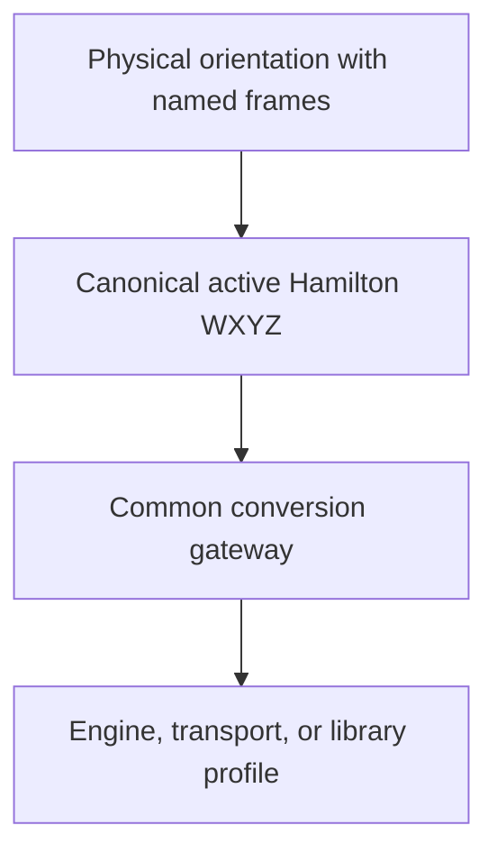

# Target converters

Physical frame meaning lives in [`quatops.experimental.semantics`](semantics.md). Hamilton
algebra, coefficient order, and unit norm do not select north, up, or a model's
front. This page covers the shared gateway from a frame-labelled physical
orientation to a declared target representation; frame meanings are supplied
by the caller unless the target API documents the specific role:

QuatOps records two separate facts for each converter: representation evidence
(for example, native-verified, specification plus test-runtime, or supporting
native evidence) and semantic authority (for example, representation-only or
standard-defined). Neither field upgrades the other. A verified coefficient
layout does not establish world/body axes. See the generated
[converter and semantic-role registry](converter-registry.md).

The `OrientationConverter` is the semantic path: callers provide source and
target parent/child frame definitions, and the gateway applies those maps.
There is no target-name lookup that invents physical axes. Generic numerical
boundaries such as `Eigen::Quaternion::coeffs()` remain representation-only;
role-specific conventions such as ROS REP-103 or Cesium ENU/ECEF are recorded
separately with the context they require. The registry describes documented
roles, not additional convenience functions unless specifically implemented.

For a role with a documented fixed basis, `bind_semantic_role()` combines its
versioned axis declaration with a required typed `FrameAlignment`. For example,
Unity's world role supplies right/up/forward and left-handedness; the
application still supplies how that scene aligns to its physical reference.
Model-local axes are declared separately and are not copied from the world
role. The gateway retains these semantic bindings, including their alignment
source and context, on `TargetOrientation` and batch results; reverse
conversion checks that they still match. A manually received native value must
be constructed with an explicit frame interpretation. Runtime spaces such as
OpenXR require a runtime-supplied alignment.
For OpenXR, the executable roles distinguish VIEW as a sensor frame from
LOCAL and LOCAL_FLOOR as world frames. Each binding records its matching
reference-space type, session, opaque identities for the actual `XrSpace` and
base-space handles, runtime, and signed `XrTime`;
it also requires the orientation-valid location flag and retains the tracked
flag separately. STAGE and generic action spaces need their own explicit
frame declaration. A binding's source says where the alignment came from,
but QuatOps cannot determine whether an application declaration matches a
real sensor mount or survey.
Cesium ENU uses
`bind_cesium_enu_frame()` with typed geodetic-origin and ellipsoid values; its
result gives the local axis basis in the declared ECEF reference. Geodetic
height and ellipsoid shape can affect Cesium's computed up axis, so both stay
in the binding context.

For a storage-order-only operation, use the separate numerical helper:

```python
from quatops.experimental.converters import reorder_quaternion_components

eigen_coeffs = reorder_quaternion_components(
    (w, x, y, z), source_order="wxyz", target_order="xyzw"
)
```

It only reorders coefficients; it does not change algebra or frame meaning.
Use `OrientationConverter` when the physical parent/child frames differ.



The gateway and target profiles live in `quatops.experimental.converters`.
`quatops.converters` remains as a deprecated compatibility facade for existing
imports; new code should use the experimental path.
For application examples, see [converter integrations](converter-examples.md).

## Canonical orientation contract

`PhysicalOrientation` means an active Hamilton WXYZ `q_parent_from_child`,
requires a finite unit quaternion within `1e-6`, and retains its supplied sign.
Its parent and child frame definitions determine separate world and body
coordinate maps. Both maps must have matching determinant parity so the
converted value remains a proper rotation. See
[physical frame semantics](semantics.md) for frame conventions, composition,
and the lower-level `FramedOrientation`.

### Sign and information preservation

Quaternion-to-quaternion profiles reorder coefficients and apply the linear
frame map, so they preserve the global sign: converting `q` and `-q` yields
target values that are antipodes. Their reverse conversion preserves the same
representative, subject to the target's numeric precision.

`opencv.rodrigues` converts through a principal rotation vector. That
representation identifies `q` and `-q`; the reverse conversion returns one
canonical quaternion representative. For this profile, round-trip correctness
means rotation equivalence, not coefficient equality. This is a property of
the represented orientation, not a failed round trip.

### Input and precision policy

The `PhysicalOrientation` gateway accepts only finite, unit Hamilton
quaternions whose norm differs from one by at most `1e-6`. It rejects other
values; call `.normalized()` explicitly if normalization is intended. Reverse
scalar and batch conversion applies the same physical-unit check to the
recovered value. The lower-level `ConverterProfile` methods accept
`FramedOrientation` values and leave unit-domain responsibility to their
caller.

`TargetOrientation` retains the complete target `CoordinateFrame` objects for
its child and parent frames. Reverse conversion requires those definitions to
match the converter context, including their basis coefficients and reference
convention. When constructing a value received from a native API, supply both
frame definitions; frame-name strings alone are not an interpretation. Values
created through `OrientationConverter` also retain semantic role bindings and
their alignment provenance/context. The reverse gateway requires that complete
binding to match, even when a replacement binding happens to use the same
numeric basis.

Scalar target values contain Python `float` coefficients and do not simulate
rounding to a target's float32 storage type. Assign or cast them through the
target API to obtain its native precision. NumPy batches must contain real,
finite values and meet the same `1e-6` unit tolerance. A signed-axis
quaternion map preserves the input batch dtype; general parent/body basis
corrections and rotation-vector conversion use float64 kernels. Shape and
component-axis behavior are documented in [Batch conversion](#batch-conversion).

## One conversion gateway

The gateway derives the two coordinate maps from the physical source frames
and the caller-declared target frames. All registered target profiles use the
same scalar and batch entry points.

```python
from quatops.experimental.converters import (
    OrientationConverter,
)
from quatops.experimental.engines import OrthogonalBasisMap
from quatops.experimental.semantics import (
    CANONICAL_BODY_RFU,
    CANONICAL_WORLD_RFU,
    CoordinateFrame,
    FrameAlignment,
    PhysicalOrientation,
    bind_semantic_role,
)
from quatops.types import HamiltonQuaternion

canonical_world = CANONICAL_WORLD_RFU.bind(
    "application.world.rfu", "application.world.axes"
)
canonical_body = CANONICAL_BODY_RFU.bind(
    "asset.body.rfu", "asset.body.axes"
)

unity_basis_in_source_world = OrthogonalBasisMap(
    ((1, 0, 0), (0, 0, 1), (0, 1, 0))
)
unity_world = bind_semantic_role(
    "unity.world-axes",
    name="application.unity-world",
    alignment=FrameAlignment(
        reference_frame=canonical_world,
        basis_to_reference=unity_basis_in_source_world,
        purpose="scene_alignment",
        provider="application",
        alignment_source="application_declaration",
        alignment_evidence_reference="app://project/coordinate-contract-v1",
    ),
)
unity_body = CoordinateFrame(
    "asset.unity-local",
    canonical_body.reference,
    ("right", "up", "forward"),
    unity_basis_in_source_world,
    "left",
    role="body",
    reference_convention=canonical_body.reference_convention,
)

physical = PhysicalOrientation(
    HamiltonQuaternion(0.8, 0.2, -0.4, 0.4),
    parent_frame=canonical_world,
    child_frame=canonical_body,
)
unity = OrientationConverter(
    "unity.quaternion",
    source_parent=canonical_world,
    source_child=canonical_body,
    target_parent=unity_world,
    target_child=unity_body,
)
native = unity.to_target(physical)
recovered = unity.from_target(native)
```

The contract supplies Unity's documented world-axis labels and handedness;
`unity_basis_in_source_world` is still the application's scene alignment. The
asset frame is declared independently. The converter retains the semantic
binding, including its evidence reference and alignment context, and exposes it
through `target_semantic_bindings`. The gateway rejects mismatched reference
identities and invalid frame pairs. The `OrientationConverter` checks that
each input uses the configured source frames and reuses its compiled frame map
for scalar and batch values. The one-shot
`convert_orientation_to_target` and `convert_orientation_from_target`
functions remain available for occasional conversions.

The lower-level `ConverterProfile.to_target` and `from_target` methods remain
available when an application already owns a `FramedOrientation` and a
compiled `SemanticQuaternionMap`.

## Batch conversion

`PhysicalOrientationBatch` attaches the same parent and child frame definitions
to an array of WXYZ values. The batch gateway accepts a configurable component
axis, checks that each input is unit length within `1e-6`, and uses the same
target profile and frame map as scalar conversion. `TargetOrientationBatch`
retains the target frame definitions and normalized component axis. Reverse
conversion uses that axis by default; an explicit override must identify the
same axis, even when a shape such as `(4, 4)` makes both axes look valid. NumPy
loads only when a batch method is called.

```python
import numpy as np
from quatops.experimental.semantics import PhysicalOrientationBatch

keys = PhysicalOrientationBatch(
    values=np.asarray(
        [(0.8, 0.2, -0.4, 0.4), (0.7, -0.3, 0.2, 0.6164414002968976)]
    ),
    parent_frame=canonical_world,
    child_frame=canonical_body,
)
native_keys = unity.to_target_batch(keys)
```

Use `unity.from_target_batch(native_keys)` to recover the physical batch.

For a signed-axis map, quaternion batch conversion is component selection and
sign changes and preserves the input dtype. General world/body corrections and
rotation-vector boundaries use float64 Hamilton NumPy kernels. No target
package is imported by QuatOps.

## Declared target boundaries and evidence status

The immutable `CONVERTERS` mapping contains every declared orientation
profile. Use `accepted_converters()` to discover only profiles accepted for
their captured scope. `get_converter()` remains available for all profiles,
including those whose evidence is declared or supporting-only. An
`OrientationConverter` exposes the selected profile's `evidence_status`; using
a profile does not upgrade its evidence claim.

The full, generated [converter and evidence-target registry](converter-registry.md)
is derived from these source declarations. It includes the target API, version,
layout, evidence state, and scope for converters, frame providers, format
validators, and loader observations.

These orientation profiles do not implement target object construction,
serialized asset authoring, pose translation, time sampling, or runtime
lifecycle. See the [interoperability evidence atlas](INTEROPERABILITY_EVIDENCE.md)
and [shared coordinate mapping reference](engines/coordinate-mapping.md) for
accepted scope and basis equations.
